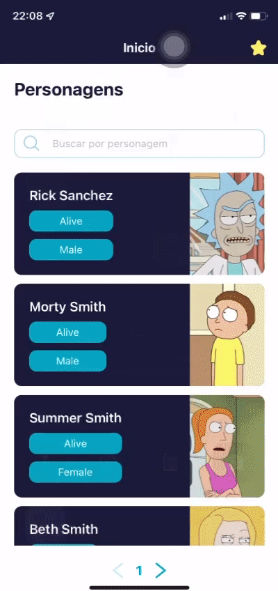
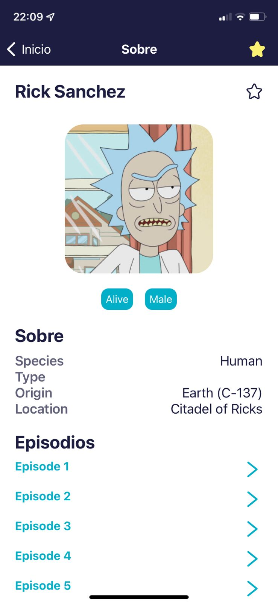
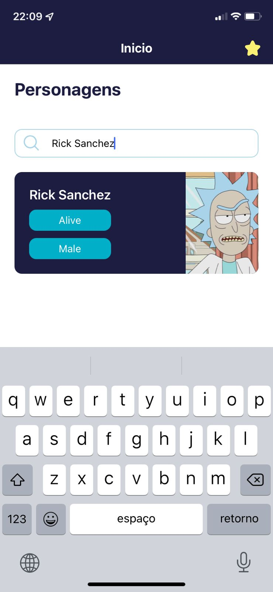
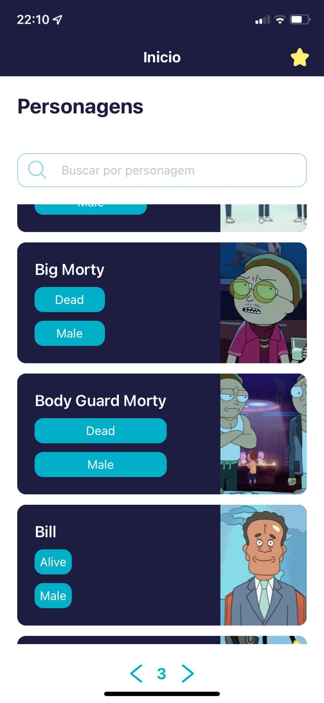

#### Veja todas as imagens em /assets/prints/



##### Motivação para o projeto

- Selecionei o exercicio do Rick Morty, pois é a primeira vez que
  me deparo com essa api, além de ser fã de carteirinha do desenho

#### Como rodar ?

- De um clone nesse repositório
- Tenha o yarn instalando na sua maquina

  - Rode yarn para baixar as dependencias

    ```
    yarn
    ```

- Executando por QR Code (maneira mais facíl):

  - tenha o aplicativo do expo go baixado em seu celular

    - no terminal rode:

    ```
    yarn start
    ```

    - escaneie o QR Code
    - obs: é necessário seu aparelho celular e computador estarem na mesma rede wifi

- Executando no Android:

  - Com o celular android conectado ao computador
  - no terminal rode:

  ```
  yarn android
  ```

- Executando no Ios (necessário um mac):

  - Com o Iphone conectado ao computador
  - no terminal rode:

  ```
  yarn ios
  ```

#### Imagens



---



---


